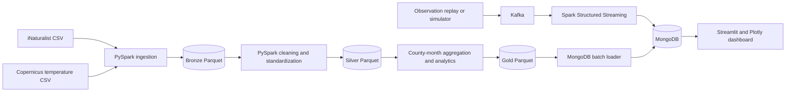

# Clouded Apollo Analytics Architecture

The platform compares Romanian county-level monthly temperatures with reported Clouded Apollo (*Parnassius mnemosyne*) observations. Historical data uses a PySpark batch pipeline and Parquet medallion layers. A Kafka and Spark Structured Streaming path processes observation events, and MongoDB serves both paths to the Streamlit dashboard.

The Kafka path currently carries butterfly observation events, not weather events. Observation counts are recorded sightings, not population estimates; correlation describes association and does not establish causation.

See [detailed architecture diagrams](docs/architecture-diagram.md), [data dictionary](docs/data-dictionary.md), [system overview](docs/architecture/system-overview.md), [batch pipeline](docs/pipelines/batch-pipeline.md), and [streaming pipeline](docs/pipelines/streaming-pipeline.md). Docker Compose and the end-to-end service path are configured but should be validated on the target machine before a live demonstration.
