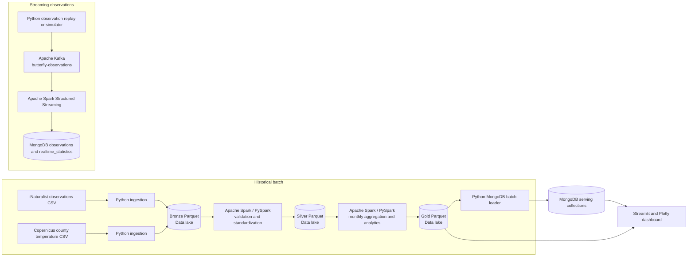
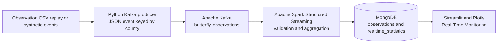

# Clouded Apollo Analytics in Romania

This project explores how monthly county-level temperature relates to recorded sightings of the Clouded Apollo (*Parnassius mnemosyne*) in Romania.

**Research question:** How are reported Clouded Apollo observations associated with environmental temperature across Romanian counties and months?

Reported sightings are not population estimates. Observer effort and reporting bias affect the records, and correlation does not establish causation.

## Team

**Team work dream work**

- Alixandrescu Elena-Adina — Bioinformatics Applied in Lifesciences
- Faur Ucu-Mihai — Bioinformatics Applied in Lifesciences
- Gergely Kinga — Bioinformatics Applied in Lifesciences
- Portik Márk-Krisztián — Software Engineering
- Zoltáni Szabolcs — Software Engineering

## Architecture



The batch path processes historical sightings and climate data through Bronze, Silver, and Gold Parquet layers. The streaming path currently carries butterfly observation events; it is not a live weather feed. See the [detailed architecture and streaming flow](docs/architecture-diagram.md).

### Streaming flow



This streaming path handles observation events and is shown separately in [architecture diagrams](docs/architecture-diagram.md).

## Technology stack

| Component | Technology / version | Purpose |
| --- | --- | --- |
| Runtime | Python 3.11+ | Ingestion, producer, storage utilities, dashboard |
| Batch and stream processing | Apache Spark / PySpark 3.5 | Transform Parquet data and consume Kafka events |
| Historical data lake | Parquet (dependency versions in Spark runtime) | Bronze, Silver, and Gold datasets under `data/` |
| Event broker | Apache Kafka, Confluent Platform 7.6.0 | Transport observation events |
| Serving store | MongoDB 7.0 | Dashboard queries, batch summaries, and realtime totals |
| Dashboard | Streamlit ≥1.37; Plotly (see requirements) | Interactive historical, temperature, correlation, and realtime pages |
| Local services | Docker Compose plugin (version depends on Docker install) | Start the local infrastructure and dashboard |
| Unit/integration tests | pytest ≥8.0; mongomock ≥4.1 | Verify processing helpers and MongoDB query behavior |

Dependency versions are specified in [requirements.txt](requirements.txt); test-only dependencies are in [requirements-dev.txt](requirements-dev.txt).

## Prerequisites

- Python 3.11 or newer
- Docker Desktop or Docker Engine with the Docker Compose plugin
- Java compatible with Spark 3.5 when running PySpark outside Docker
- The repository's source CSV files in `data/raw/`

## Quick start

Create a virtual environment, install dependencies, and configure local service addresses:

```bash
python -m venv .venv
# Windows PowerShell: .venv\Scripts\Activate.ps1
# macOS/Linux: source .venv/bin/activate
pip install -r requirements.txt
cp .env.example .env
```

Start the services and run the historical batch pipeline:

```bash
docker compose up --build -d
docker compose ps
spark-submit src/processing/run_batch_pipeline.py --stages all
```

The Compose file describes the Kafka, Spark, MongoDB, and Streamlit services. Verify that all images build and services become healthy in your Docker environment before running the pipeline. The dashboard is served at [http://localhost:8501](http://localhost:8501). Spark UI is at [http://localhost:8080](http://localhost:8080), and MongoDB is available at `mongodb://localhost:27017`.

To send a finite replay of source observations to Kafka, run:

```bash
python src/ingestion/observation_producer.py --mode replay --count 10
```

Stop services with `docker compose down`. By default, Kafka and MongoDB use named volumes; `docker compose down --volumes` also deletes their persisted data.

### Run tests

Install the development dependencies and run the unit suite:

```bash
pip install -r requirements-dev.txt
pytest tests/ -v
```

The end-to-end test uses the checked-in CSV files and requires a local test MongoDB. Start it in another terminal with `docker compose -f docker-compose.test.yml up -d`, then run `pytest tests/test_integration.py -v`. It uses port 27018 and removes its isolated test database when finished.

## Project structure

```text
config/                 County aliases and Spark configuration
data/raw/               Source observation and temperature CSV files
data/bronze/            Ingested source-aligned Parquet (generated)
data/silver/            Validated and standardized Parquet (generated)
data/gold/              Monthly statistics and analytical outputs (generated)
docker/                 MongoDB, Spark, and Streamlit container files
docs/                   Architecture, pipeline, schema, and development docs
scripts/                Local service and connectivity helpers
src/ingestion/          CSV ingestion and Kafka observation producer
src/processing/         Bronze-to-Silver, Gold, analytics, orchestration
src/storage/            MongoDB batch loader and query client
src/streaming/          Kafka Structured Streaming consumer and aggregations
src/dashboard/          Streamlit entry point and analytical pages
tests/                  Unit tests and the Docker-backed integration test
```

## Data sources

- **iNaturalist observations:** the repository's `Parnassius_obs_cleaned.csv` contains observation IDs, dates, coordinates, and county names. iNaturalist describes its community science platform at [iNaturalist About](https://www.inaturalist.org/pages/about).
- **Copernicus temperatures:** `Romania_County_Monthly_Temperatures_2000_2026.csv` contains county-level monthly mean temperatures in °C. Copernicus Climate Data Store information is available at [climate.copernicus.eu/climate-data-store](https://climate.copernicus.eu/climate-data-store).

The processing pipeline reads the provided local files. The source records and their derived aggregates have different sampling and coverage properties; see [data dictionary](docs/data-dictionary.md).

## Pipeline stages

1. **Ingest to Bronze:** PySpark validates required source columns, adds ingestion metadata, and writes Parquet.
2. **Bronze to Silver:** parse dates and numeric coordinates, standardize county aliases, flag coordinates outside the broad Romania bounds, remove duplicate observation IDs, and unpivot monthly temperatures.
3. **Silver to Gold:** count observations by county/year/month, join them to available temperature months, and classify temperature bands.
4. **Gold analytics:** calculate county, year, and overall Pearson correlations with p-values, yearly trends, and seasonal summaries.
5. **MongoDB serving:** upsert observations, monthly statistics, and correlations for dashboard reads.
6. **Streaming:** replay or synthesize observation events to Kafka; Spark validates and upserts accepted observations and per-county realtime statistics to MongoDB.
7. **Dashboard:** query MongoDB to show historical observation patterns, temperature summaries, correlations, and a live monitoring view.

For detailed component flows see [batch pipeline](docs/pipelines/batch-pipeline.md), [streaming pipeline](docs/pipelines/streaming-pipeline.md), and [MongoDB data model](docs/data-model.md).

## Dashboard screenshots

The dashboard contains Historical Analysis, Temperature Analysis, Correlation Analysis, and Real-Time Monitoring pages. Screenshots are not included yet; capture them after starting the app with representative MongoDB data so that each image reflects the rendered application rather than a placeholder. The pages and their required data are described in [dashboard documentation](docs/README.md).

## Known limitations

- The observation dataset is small (71 records in the supplied snapshot) and represents reported sightings, not population abundance.
- Citizen-science observations can be affected by observer effort, access, season, and reporting behavior.
- Copernicus monthly county averages and sightings are aggregated at different source grains; correlation is descriptive and does not demonstrate causality.
- Missing temperature measurements remain null; absence of an observation record does not prove that butterflies were absent.
- The streaming implementation publishes butterfly observation events, while the original proposal discussed incoming weather events.
- Docker Compose and the full batch-to-dashboard flow require validation on the target machine; the integration test is opt-in and requires its MongoDB service.

## References

1. iNaturalist. [About iNaturalist](https://www.inaturalist.org/pages/about).
2. Copernicus Climate Change Service. [Climate Data Store](https://climate.copernicus.eu/climate-data-store).
3. Haris, A., Józan, Z., Roller, L., Šima, P., & Tóth, S. (2024). Changes in Population Densities and Species Richness of Pollinators in the Carpathian Basin during the Last 50 Years (Hymenoptera, Diptera, Lepidoptera). *Diversity, 16*(6). [https://doi.org/10.3390/d16060328](https://doi.org/10.3390/d16060328).
4. Rákosy, L. et al. (2021). *Romanian Red List of Lepidoptera*. [Reference record](https://www.researchgate.net/publication/373633048_Romanian_Red_List_of_Lepidoptera_2021).
5. Vizauer, T.-C., Crișan, A., & Rákosy, L. (2025). The status of protected butterfly species in Romania in the context of national and EU legislation. *Entomologica Romanica, 29*, 48–65. [https://doi.org/10.24193/entomolrom.29.27](https://doi.org/10.24193/entomolrom.29.27).

## Further documentation

Start at the [documentation index](docs/README.md) for architecture decisions, component contracts, pipeline details, MongoDB schema, and the Git workflow.
