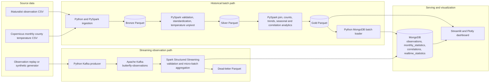
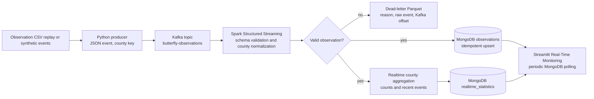

# Architecture Diagrams

The diagrams show the repository's implemented data paths. Historical temperature data is handled in the batch pipeline. Kafka currently carries Clouded Apollo observations, not weather events.

## End-to-end architecture

## Streaming flow

The historical batch path reads local source CSVs into Parquet and then MongoDB. Docker Compose defines the local service topology; see the [quick start](../README.md#quick-start) and [service configuration](../docker-compose.yml).
