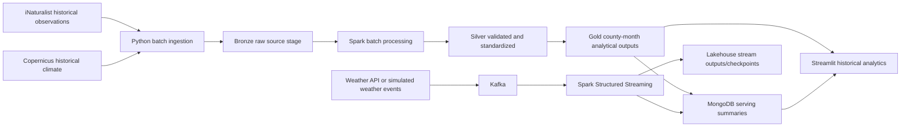

# Architecture layer guides

These guides explain the responsibility, boundaries, and planned code locations for each part of the accepted architecture. The repository is still at the documentation stage, so paths below are **planned locations** unless the guide identifies a file as present. Confirm source schemas and implementation choices before treating examples as final contracts.

## Guides

- [Data sources](01-data-sources.md) — historical ecological/climate inputs and the incoming weather stream.
- [Batch ingestion](02-batch-ingestion.md) — loading historical inputs into raw/Bronze storage.
- [Batch storage and lakehouse](03-batch-storage.md) — Bronze, Silver, and Gold responsibilities and formats.
- [Batch processing](04-batch-processing.md) — Spark transformations and orchestration.
- [Streaming ingestion](05-stream-ingestion.md) — producing weather events and transporting them through Kafka.
- [Stream processing](06-stream-processing.md) — validating and aggregating incoming events with Spark Structured Streaming.
- [Speed/serving storage](07-serving-storage.md) — MongoDB's low-latency query role and data ownership.
- [Serving and visualization](08-serving-visualization.md) — dashboard queries, pages, and interpretation requirements.
- [Planned repository file map](file-map.md) — what each anticipated file is for and the issue that owns it.

## Data flow at a glance

The accepted proposal and diagram define the streaming input as weather data. Some existing GitHub issues describe a butterfly-observation stream instead; resolve that mismatch before implementing those tickets. The issue file lists are intended to guide implementation and review, not silently change an issue's acceptance criteria.
