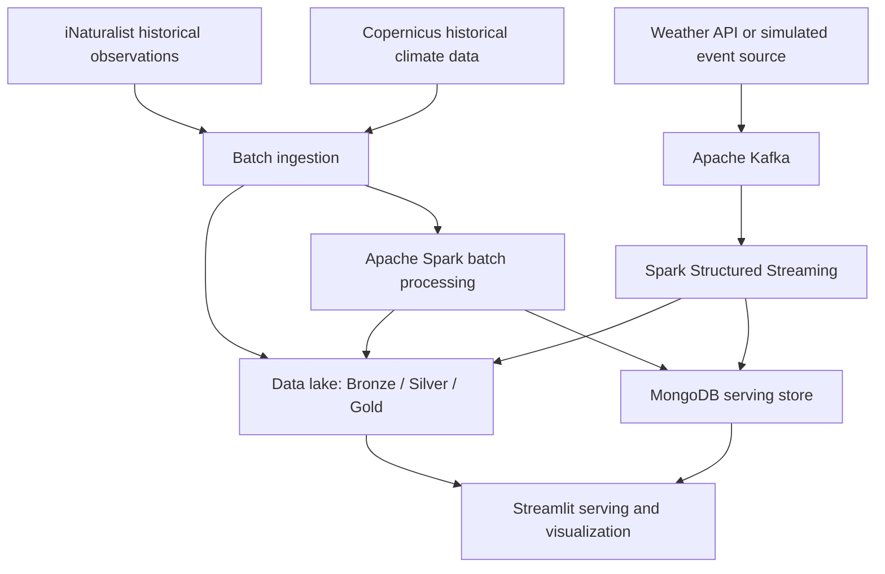

# Architecture

## Status

This is the **proposed** architecture from the accepted proposal and supplied diagram. The repository has no implementation yet, and the choices below are not claims that services are already running. The proposal permits refinement as the team confirms implementation constraints.

For per-layer responsibilities and planned file ownership, see the [architecture layer guides](layers/README.md) and [planned repository file map](layers/file-map.md).

## Logical flow

The image depicts historical sources flowing to batch ingestion and a lakehouse. Incoming weather flows through Kafka and Spark Structured Streaming, with results available in the lakehouse and MongoDB. Spark processes lakehouse layers; Streamlit presents historical analytics and low-latency recent summaries.

## Components

| Layer | Proposed component | Responsibility |
| --- | --- | --- |
| Sources | iNaturalist; Copernicus Climate Data Store | Historical observation and climate inputs. |
| Streaming source | Weather API or simulated stream | Supply incoming weather events for near-real-time demonstration. Exact source is open. |
| Batch ingestion | Python ingestion scripts | Load source files/API results into raw storage with provenance. |
| Stream ingestion | Apache Kafka | Buffer and transport incoming events to consumers. |
| Batch storage | Data lake with Delta Lake or Apache Iceberg | Organize raw, cleaned/joined, and analytical data into Bronze, Silver, and Gold stages. Table format and storage location are open. |
| Batch processing | Apache Spark | Clean, standardize, integrate, aggregate, and analyze historical data. |
| Stream processing | Spark Structured Streaming | Validate and summarize incoming events, then write outputs to serving and/or lake storage. |
| Speed/serving storage | MongoDB | Provide low-latency access to recent summaries and analytical results. Collection design and sync strategy are open. |
| Visualization | Streamlit | Serve charts, tables, comparisons, and reports for historical and recent data. |

## Data stages

- **Bronze:** source-preserving raw records, including source metadata and ingestion time where available.
- **Silver:** validated and standardized records, with documented geographic/time normalization and deduplication rules.
- **Gold:** integrated county/month datasets and aggregates suitable for analysis and dashboards.

These are proposed logical stages; exact file formats, table names, partitioning, and retention are undecided.

## Important interfaces to define during implementation

- Source record schemas and provenance fields.
- Timestamp, timezone, temperature unit, county naming/code system, and spatial matching rules.
- Kafka topic names, event schema, serialization, delivery behavior, and checkpointing.
- How live observations are joined to historical climate data, if at all.
- How Gold data is synchronized to MongoDB and how updates/replays avoid duplicates.
- Local development and deployment topology, resource requirements, and failure recovery.

## Operational qualities

The course asks for scalability considerations, coherent integration, reproducibility, and deployment/execution documentation. Containerization, monitoring, CI/CD, cloud, and infrastructure-as-code are encouraged but optional. Document chosen operational behavior once implemented, including configuration, checkpoints, error handling, and restart procedure.
