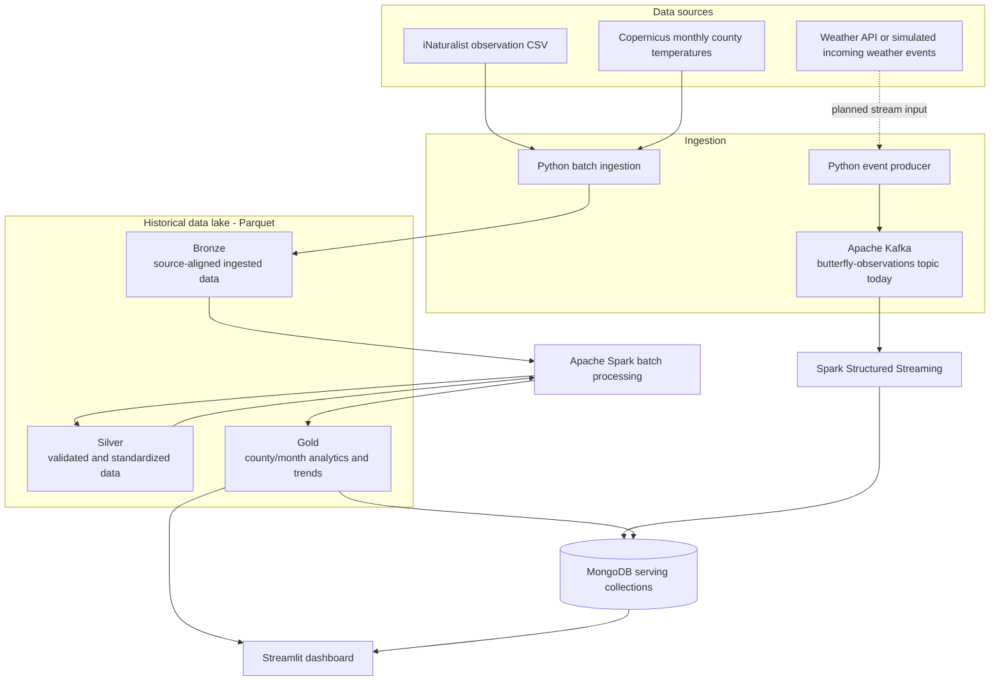

# System Architecture

## Purpose

The system studies whether county-level temperature variation is associated with reported Clouded Apollo (*Parnassius mnemosyne*) observations in Romania. It combines historical iNaturalist observations and Copernicus temperature data, supports a near-real-time input stream, computes descriptive and correlation analytics, and serves results through a dashboard.

Reported observations are a measure of recorded sightings, not a direct estimate of the wild population. Observer activity, access to locations, seasonality, and data completeness can affect the counts. Correlation results describe association and do not establish causation.

## Target architecture

The supplied proposal diagram is preserved at [architecture_final.jpeg](../assets/architecture_final.jpeg). The Mermaid diagram below expresses its main data flows and marks the event topic that currently exists in the repository.

The diagram shows the intended architecture and marks the Kafka topic name currently configured in the repository. The current producer replays historical butterfly observations or generates synthetic butterfly observation events; it does **not** ingest weather events. Aligning this with the proposal's weather stream is an outstanding design and implementation decision. The batch pipeline currently stores Parquet files in local `data/` directories; Delta Lake and Apache Iceberg are alternatives shown in the supplied diagram, not technologies currently configured by this repository.

## Component definitions and responsibilities

| Component | Definition and responsibility | Current repository status |
| --- | --- | --- |
| Data sources | Historical Clouded Apollo sightings and monthly county temperature data; target stream is incoming weather data. | Two CSV inputs are in `data/raw/`. Streaming currently sends butterfly observation events. |
| Batch ingestion | Loads source files without replacing the original source data and writes ingested data for repeatable processing. | Implemented in `src/ingestion/ingest_observations.py` and `ingest_temperatures.py`. |
| Kafka | Durable event broker that decouples an event producer from its stream processor. | Compose defines Kafka and a topic initializer for `butterfly-observations`. |
| Data lake | File-based storage for historical inputs and transformations. | Local folders under `data/`; the processing scripts use Parquet. |
| Bronze | Ingested data kept close to its source representation, with ingestion metadata where appropriate. | Separate observation and temperature outputs are defined by the batch pipeline. |
| Silver | Validated, cleaned, standardized records ready to join or aggregate. | Observation and temperature transformation stages are implemented. |
| Gold | Curated analytical outputs such as county/month summaries, correlations, trends, and seasonal patterns. | Output stages are defined in the batch pipeline. |
| Spark batch | Distributed processing engine for historical cleaning, joins, aggregations, and analytics. | Pipeline stages exist; end-to-end execution remains unverified. |
| Spark Structured Streaming | Reads Kafka events in micro-batches, validates them, and updates low-latency outputs. | Consumer handles observation events, dead letters, checkpoints, and MongoDB upserts. |
| MongoDB | Document serving store for recent records and precomputed summaries used by the dashboard. | Initialization and storage modules exist; collection schema is documented in the data model. |
| Streamlit | User-facing dashboard for historical and near-real-time results. | Historical, temperature, correlation, and realtime pages are implemented. |
| Docker Compose | Local orchestration for infrastructure and application services. | `docker-compose.yml` defines a shared network, persistent Kafka/MongoDB volumes, Kafka topic initialization, health checks, and a shared Spark 3.5.9 image; a successful full-stack run still needs validation on the target machine. |

## Data flow definitions

### Historical flow

1. Load the iNaturalist and Copernicus CSV files from `data/raw/`.
2. Ingest each source into its Bronze Parquet output.
3. Validate fields, standardize county names and dates, and write Silver outputs.
4. Aggregate butterfly observations and temperatures by county and month.
5. Calculate descriptive trends, seasonal patterns, and temperature-observation correlations.
6. Persist analytical outputs as Gold Parquet and load the serving datasets to MongoDB.
7. Query MongoDB and Gold outputs from the dashboard.

### Near-real-time flow

The implemented stream publishes butterfly observation events through Kafka and Spark Structured Streaming, then exposes recent results through MongoDB and the Streamlit Real-Time Monitoring page. The proposal's weather-event stream remains an architecture gap until its source and contract are aligned.

## Architecture boundaries

- The project is an end-to-end data engineering and analytics platform; machine learning is optional under the course brief.
- Monthly county summaries are the common grain for historical comparison of observations and temperature.
- Do not describe iNaturalist counts as population size.
- Do not interpret correlation as evidence that temperature causes changes in butterfly abundance.
- Local Parquet is the implemented data lake format. Delta Lake and Iceberg remain alternatives unless explicitly adopted and implemented.

